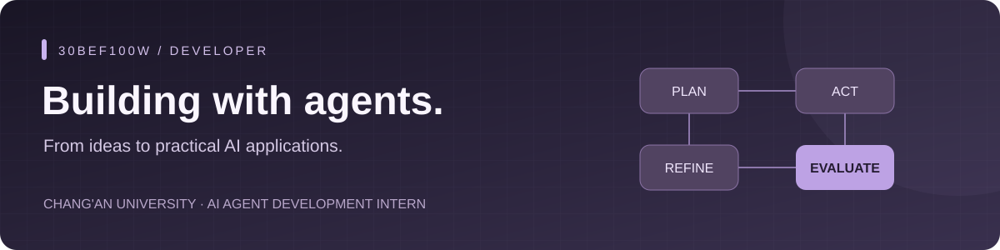

  

  <b>Chang'an University · AI Agent Development Intern</b> 
  Building practical AI applications, one workflow at a time.

  <a href="https://github.com/30bef100w/interview-agent">DeepAsk</a> &nbsp; / &nbsp;
  <a href="https://github.com/30bef100w/hmdp-pro">HMDP-Pro</a> &nbsp; / &nbsp;
  <a href="https://github.com/pulls?q=is%3Apr+author%3A30bef100w+archived%3Afalse">Open-source activity</a>

### A little about me

I'm a student at **Chang'an University**, currently working as an **AI Agent Development Intern**. I'm interested in turning language models into useful applications through structured workflows, retrieval, and reliable backend engineering.

I learn by building projects, testing ideas, and contributing to open source.

### Open-source contributions

Four upstream pull requests merged across three projects, with seven additional backend and Agent framework fixes currently open for review. Each entry links to the official PR and summarizes the engineering problem it addresses.

<table>
<tr>
<td>MERGED</td>
<td style="white-space: nowrap;"><nobr><a href="https://github.com/Tencent/WeKnora/pull/5298"><b>WeKnora #5298</b></a></nobr></td>
<td>Enabled the built-in assistant to configure, replace, preserve, and clear ReRank models through the backend agent-update path.</td>
</tr>
<tr>
<td>MERGED</td>
<td style="white-space: nowrap;"><nobr><a href="https://github.com/Tencent/WeKnora/pull/5299"><b>WeKnora #5299</b></a></nobr></td>
<td>Preserved Neo4j error chains and transaction-consumption failures so retryable graph-write errors reach the driver's retry classifier.</td>
</tr>
<tr>
<td>MERGED</td>
<td style="white-space: nowrap;"><nobr><a href="https://github.com/agentscope-ai/agentscope/pull/3774"><b>AgentScope #3774</b></a></nobr></td>
<td>Preserved Pydantic <code>$defs</code> in model-card JSON Schemas so nested and enum tool parameters remain valid.</td>
</tr>
<tr>
<td>MERGED</td>
<td style="white-space: nowrap;"><nobr><a href="https://github.com/gepa-ai/gepa/pull/568"><b>GEPA #568</b></a></nobr></td>
<td>Added Python 3.15 core-package compatibility and an independent CI validation path.</td>
</tr>
<tr>
<td>OPEN</td>
<td style="white-space: nowrap;"><nobr><a href="https://github.com/Tencent/WeKnora/pull/5376"><b>WeKnora #5376</b></a></nobr></td>
<td>Normalizes source-relative Markdown links in stored Wiki content and provides versioned repair with conflict detection.</td>
</tr>
<tr>
<td>OPEN</td>
<td style="white-space: nowrap;"><nobr><a href="https://github.com/cloudwego/eino/pull/1480"><b>Eino #1480</b></a></nobr></td>
<td>Stabilizes duplicate and empty tool-call identities across execution addresses, interrupt recovery, and stream checkpoints.</td>
</tr>
<tr>
<td>OPEN</td>
<td style="white-space: nowrap;"><nobr><a href="https://github.com/cloudwego/eino/pull/1488"><b>Eino #1488</b></a></nobr></td>
<td>Stops summarization retries and model failover after caller cancellation, preserving conversation state and provider-local timeout retries.</td>
</tr>
<tr>
<td>OPEN</td>
<td style="white-space: nowrap;"><nobr><a href="https://github.com/cloudwego/eino/pull/1489"><b>Eino #1489</b></a></nobr></td>
<td>Makes RAG reciprocal rank fusion deterministic for tied scores and duplicate document payloads across retrievers.</td>
</tr>
<tr>
<td>OPEN</td>
<td style="white-space: nowrap;"><nobr><a href="https://github.com/QwenLM/Qwen-Agent/pull/1057"><b>Qwen-Agent #1057</b></a></nobr></td>
<td>Adds lifecycle hooks around Agent tool execution for audit metadata, policy denial, and error observation.</td>
</tr>
<tr>
<td>OPEN</td>
<td style="white-space: nowrap;"><nobr><a href="https://github.com/crewAIInc/crewAI/pull/9350"><b>CrewAI #9350</b></a></nobr></td>
<td>Rejects synchronous tools before async execution so <code>arun()</code> cannot trigger side effects or consume usage budget.</td>
</tr>
<tr>
<td>OPEN</td>
<td style="white-space: nowrap;"><nobr><a href="https://github.com/microsoft/autogen/pull/8474"><b>AutoGen #8474</b></a></nobr></td>
<td>Preserves Anthropic tool policies and schema constraints such as <code>strict</code> and <code>additionalProperties</code>.</td>
</tr>
</table>

### Featured projects

<table>
<tr>
<td width="100%" valign="top">
<h3><a href="https://github.com/30bef100w/interview-agent">DeepAsk</a></h3>

<b>AI-powered mock interviews</b>

Resume-aware question planning, structured follow-ups, code evaluation, and explainable feedback.

Exploring how planning and state management make multi-turn agent workflows more useful.

<code>Python</code> <code>FastAPI</code> <code>Next.js</code>

</td>
</tr>
<tr>
<td width="100%" valign="top">
<h3><a href="https://github.com/30bef100w/hmdp-pro">HMDP-Pro</a></h3>

<b>Backend engineering in practice</b>

A learning project extending the Heima Dianping course project with flash-sale workflows, transactional messaging, layered caching, and order reconciliation.

<code>Java</code> <code>Redis</code> <code>MySQL</code> <code>RocketMQ</code>

</td>
</tr>
</table>

### What I'm exploring

- **Agent workflows** — planning, tool use, and multi-turn state management.
- **Retrieval & evaluation** — grounding responses and checking whether an application does its job.
- **Reliable systems** — APIs, caching, messaging, and practical debugging.

---

Build with curiosity. Improve with evidence. Share what you learn.

